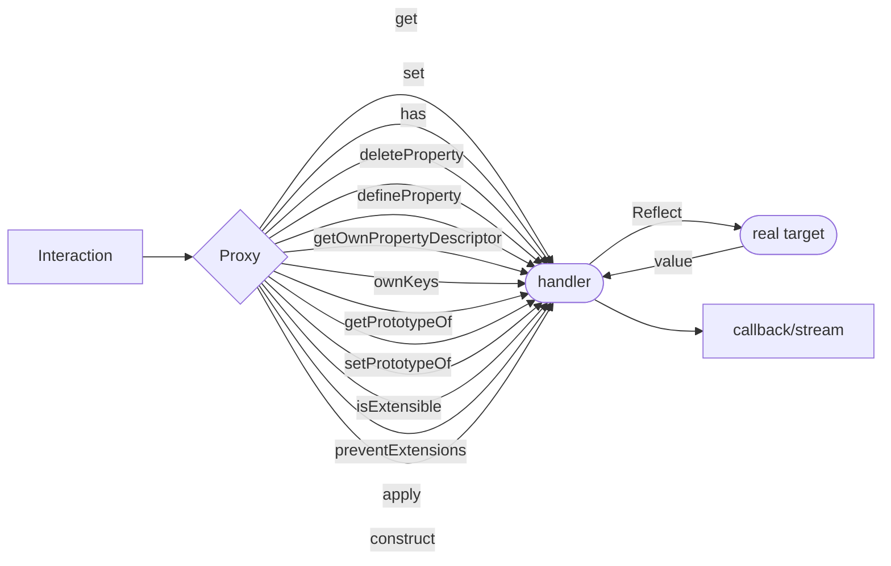
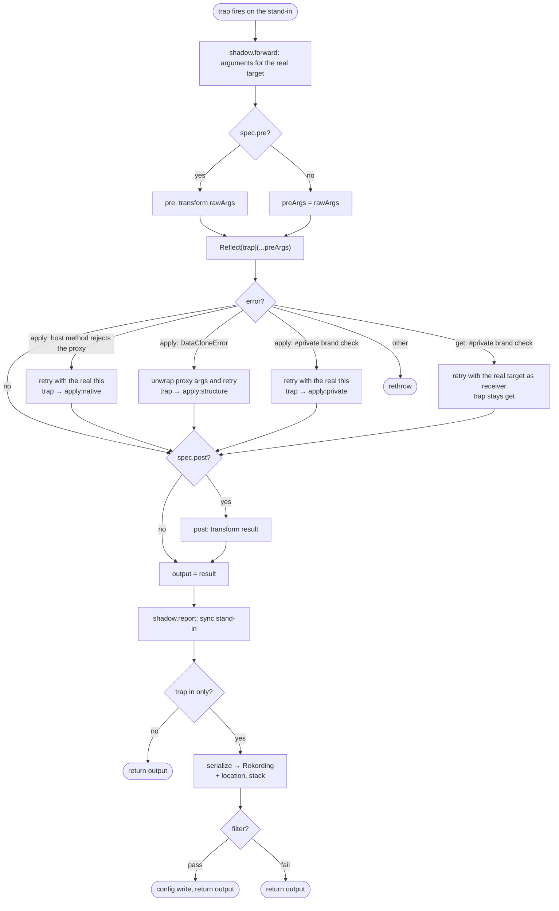
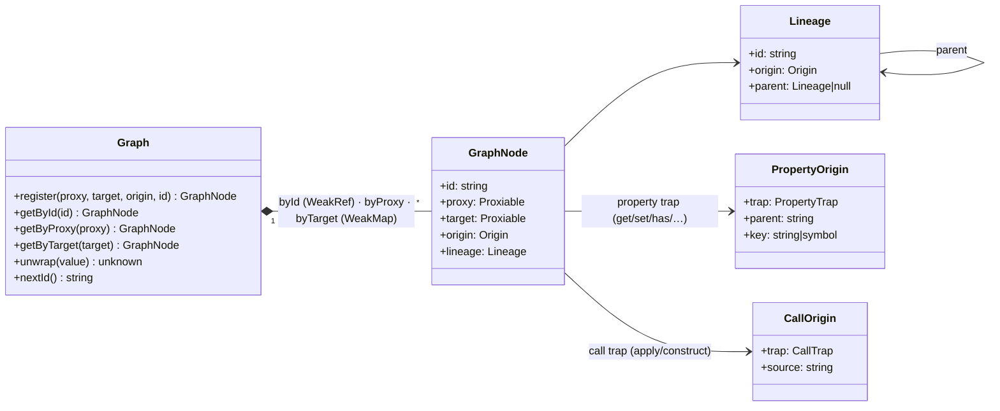

# Design notes

A record of what was tried before the current implementation, and why each approach was abandoned. Useful background for contributors wondering why certain decisions were made.

For a higher-level explanation of the final design, see the [How it works](README.md#how-it-works) section of the README.

---

## Proxy mechanics

A `Proxy` wraps a real target object. Every operation the caller performs on the proxy — property read, assignment, function call, construction — is intercepted by the JS engine and routed to the corresponding named trap. The trap calls `Reflect[trap]` to forward the operation to the real target and returns the result.

If no handler is defined for a trap, the JS engine forwards directly to the target — a Proxy with an empty handler is fully transparent.

---

## Approaches tried

### Path-tracking stream recorder

Maintained path arrays alongside objects in a WeakMap, emitted stream records with kind, path, and timestamp.

**Problem:** No stable proxy identity — the same object returned different proxies on repeated access. Path arrays duplicated across WeakMaps became inconsistent. No parent-child relationship surveyable from records alone.

**Carried forward:** Stream-based output option, path reconstruction concept.

---

### Lightweight callback recorder

Minimal event-per-trap model: id, timestamp, kind, path, params, result stored per event.

**Problem:** Too simple. Results stored by-value risked circular references. Path arrays rebuilt on every trap fire. Events disconnected from each other — no parent chain.

**Carried forward:** Nothing significant.

---

### Numeric IDs + child-sink pattern

Each proxy got a numeric ID; child logs created via `Array.slice(0, 0)` to respect `Symbol.species`. Tracked parent-child via ID references.

**Problem:** Numeric IDs non-portable across serialization boundaries. Results stored directly in logs risked circular references. No trap filtering. The array child-sink pattern was obscure and fragile.

**Carried forward:** Structured Origin concept (trap/parent/key mapping), per-proxy metadata pattern.

---

### Observation modes + serialization

Introduced three observation modes (group/explicit/key-first) and `{ $proxy: id }` serialization tags. Trap filtering. Closure-based wrapping for recursive proxy creation.

**Problem:** `defineProperty` spec forced `configurable/enumerable/writable=true`, breaking `Array.push`. Key-first mode was incomplete. Origin simplified to `string | symbol`, losing the trap type information needed for replay.

**Carried forward:** `{ $proxy: id }` serialization strategy, origin extraction via spec functions, trap filtering concept.

---

### Minimal origin + direct recording

Simplified origin to `string | symbol | null`, smaller memory footprint, inline wrap functions in specs.

**Problem:** Records not JSON-serializable due to circular reference risk. Origin lost trap type information entirely. `getAncestors()` broke when proxies were GC'd — the implementation stored the parent proxy itself rather than its ID, preventing collection.

**Carried forward:** Origin extraction pattern, memory footprint discipline.

---

## What made it into the final design

The trap handler in `makeProxy` follows this flow for every intercepted operation:

The retries recognise each engine's wording of the error; see [Brand checks in every engine](#brand-checks-in-every-engine-and-binary-data). `apply:private` and the `get` retry are skipped with `bind: false`.

| Decision | Rationale |
|---|---|
| Structured `Origin { trap, parent, key }` | Survives GC; distinguishes trap types; reconstructible from records alone |
| `{ $proxy: id }` serialization tags | JSON-safe, no circular reference risk, resolvable via `getProxyById` |
| Stream or callback output | Both covered: streaming for persistence, callback for in-process inspection |
| Origin extraction via spec pre/post hooks | Keeps trap handler generic; per-trap concerns stay in one place |
| `only` selects records, not behaviour | Every trap behaves the same — results proxied, native boundaries retried — and `only` decides which traps produce a record. Until 2.0.0, traps left out of `only` were relayed raw: their results were not proxied, so `only: ['apply']` saw no nested calls, leaving out `construct` handed out raw instances, and native methods threw without the retries. Choosing what to record changed what the application saw. A trap left out now skips only the record's cost: ID, serialization, location and stack. Limiting how far the recorder reaches is `recursive: false`; a per-trap `follow` waits for a real need |
| Proxy stability guarantee | Same object → same proxy, regardless of how many times it is accessed |
| Native slot detection + bind cache | Allows `Map`, `Set`, `WeakMap`, `WeakSet`, `Date` to be proxied and recorded; probe runs once per prototype, bind cache maintains stability for method results |
| No double-wrapping guard | Prevents infinite loops when proxied values are passed back into proxied functions |
| Weak ID index + lineage | The index by ID held every node strongly, so a session kept everything it touched alive — a leak in any long-running process. It now holds `WeakRef`s, with a `FinalizationRegistry` removing entries of collected nodes; a node lives as long as its target. Each node's lineage (ID, origin, parent lineage) keeps paths intact without keeping ancestors alive |
| Stand-in (shadow) target | The engine checks invariants against the proxy's own target. Wrapping an empty stand-in, synced only as far as the invariants demand, lets frozen and read-only values be proxied — and recorded — instead of passed through raw |

## What was abandoned and why

| Abandoned | Reason |
|---|---|
| Path arrays per object | Replaced by origin chain walking — more compact, reconstructible from records |
| Numeric IDs | Switched to `#`-prefixed strings — human-readable and JSON-safe |
| Direct object storage in logs | Full serialization required for streaming, logging, and replay |
| `Symbol.species` child-sink | Unnecessary complexity; WeakMap per-proxy metadata is more reliable |
| Three observation modes | A single `only` allowlist covers the real use cases with less API surface |
| Origin as `string \| symbol` | Full Origin struct needed to distinguish trap types during replay |
| Unserializable records | Non-starter for the stream output use case |

---

## Proxy invariants and the stand-in target

Every approach above proxied the real target directly. The engine holds a proxy to that target: a non-configurable, read-only property (frozen objects, class `prototype`, the getters TypeScript and Babel emit for re-exports) must be reported with exactly the target's value, getter and setter, and extensibility must match. Returning a proxy for such a value throws a `TypeError`.

The first sighting was in the initial implementation: `get` returned `prototype` unwrapped. It was treated as a special case for one key rather than as a class of problem, and the property-based tests excluded `prototype` from their keys and never generated frozen, sealed or non-configurable input, so the general case went unnoticed until a frozen object crashed `get`, `getOwnPropertyDescriptor`, spread and `defineProperty`.

A first fix passed pinned values through unwrapped. That kept the application safe, but everything done with such a value — every call through a frozen exports object — went unrecorded. The current design instead gives each proxy an empty stand-in of the same kind as its target (`Shadow` in `shadow.ts`) — the technique known from membranes (Van Cutsem & Miller, *Trustworthy Proxies*, 2013):

- Every trap relays to the real target; the engine checks the results against the stand-in.
- `get`, `set`, `has` and `deleteProperty` need nothing from an empty stand-in.
- `getOwnPropertyDescriptor` and `defineProperty` copy a non-configurable property onto it, holding the value as the proxy reports it; from then on, every trap reports that copy.
- `ownKeys`, `isExtensible`, `preventExtensions`, `getPrototypeOf` and `setPrototypeOf` lock the stand-in once the real target is no longer extensible, including when it was frozen around the proxy.
- Stand-ins for callables are strict-mode functions (sloppy ones carry non-configurable `arguments` and `caller`), and constructable only when the target has its own `prototype`.
- Every trap is installed, also those left out of `only`: without a handler the engine would act on the stand-in. Those traps do everything a recorded trap does, except produce a record.

A property-based test builds targets of any integrity level and property shape and compares flugrekorder against a transparent `new Proxy(target, {})`. The reference is a proxy rather than the target, because engines take shortcuts no handler can reproduce: V8 reports an empty non-extensible array as frozen, while its `length` is writable.

One case cannot be satisfied: once the stand-in holds a wrapped copy of a non-configurable, read-only property, an explicit `defineProperty` call on the proxy with the raw value taken from the real target is held against that copy by the engine — after the trap returns, whatever it did. The trap can only choose between refusing (`false`) and the engine throwing; it refuses. On the real target the call is a no-op, the only redefinition a frozen property allows. Assignment is not affected: assigning to a read-only property fails on the target before the stand-in is involved, and the copy of a writable property accepts any value. The alternative — copying the raw value — would make every trap report it raw, which is the unrecorded pass-through this design replaced.

## Notable additions with no predecessor

Each `create()` call produces one `Graph`, which holds three lookup indices over `GraphNode` entries. Every node links a proxy to its original target and its `Origin` — the record of how the proxy was reached:

`origin` is `null` for the root node (the value passed directly to `create()`).

**Graph class** — Session-scoped registries (`byId`, `byProxy`, `byTarget`) per `create()` call, making each proxied tree GC-eligible and self-contained. Earlier approaches used module-level maps, causing memory leaks under repeated use. `byProxy` and `byTarget` are `WeakMap`s, so a node lives as long as its target. `byId` holds `WeakRef`s, and a `FinalizationRegistry` removes the entries of collected nodes; runtimes without either keep nodes by ID strongly. `getById` — and with it `getProxyById` — returns nothing for a collected node.

**Lineage** — Each node carries its ID, its origin and its parent's lineage, and nothing from the application. A proxy still in use keeps the lineage of its ancestors, so `getPath` and `getAncestors` work after the ancestors themselves are collected.

**Promise special case** — Native Promise methods check for the `[[PromiseState]]` internal slot and throw if `this` is a Proxy. flugrekorder returns a new Promise that proxies the settled value instead, maintaining the stability guarantee across async boundaries.

**Native internal slot detection** — ECMAScript built-ins such as `Map`, `Set`, `WeakMap`, `WeakSet`, and `Date` store state in internal slots that a Proxy cannot carry. Accessing their properties or calling their methods with `this` as a Proxy throws `TypeError`. flugrekorder probes each object's prototype chain once (cached per prototype, result discarded safely via a write-suppressing blank Proxy) to detect this boundary. For detected types, the `get` trap swaps the receiver to the real target (fixing getter-based checks like `Map.prototype.size`) and binds method results to the real target before wrapping (fixing apply-level checks like `Map.prototype.get`). A stable bind cache ensures the same bound function proxy is returned on every access, preserving the proxy stability guarantee.

**`known` vs `wrap`** — Dual-mode wrapping prevents unbounded proxy creation when plain data is passed to proxied functions. `wrap` creates new proxies freely (for results, stored values and constructor arguments); `known` only wraps values already in the graph (for call arguments). A value created by a trap — a call's result, an instance from `construct` — is in the graph from then on, so passing it on to another function passes its proxy.

**`isECMABuiltin` guard and the C++ binding crash** — The native slot detection described above identifies both ECMAScript built-ins (`Map`, `Set`, `Date`, …) and Node.js C++ bindings (`TCP`, `ConnectionsList`, `HTTPParser`, …) as slot-bearing. The two kinds behave differently at the boundary: ECMAScript built-ins perform a JavaScript-level type check before touching their internal fields, so they throw a catchable `TypeError` when called through a Proxy; C++ bindings skip the JS check entirely and call `v8::Object::GetAlignedPointerFromInternalField` directly, which fatally aborts the process if the object has no internal fields — as a Proxy does not.

The crash had three contributing paths. The primary one was subtle: `Reflect.set(target, key, value, proxyReceiver)` routes through the `defineProperty` trap when the receiver is a Proxy. The existing `defineProperty.pre` was wrapping all descriptor values unconditionally, so `this._handle = new TCP()` inside `net.Server.listen()` — with `this` as the server proxy — stored a Proxy of the TCP handle back into the real target. Native C++ code later received that Proxy as an argument, called `Unwrap<T>()` without a prior JS type check, and crashed. The other two paths were the `get.post` hook recursively proxying C++ handle objects returned from property accesses, and the `apply` trap forwarding the Proxy as `this` to native methods.

`isECMABuiltin` distinguishes the two kinds by explicit allowlist (Promise, Map, Set, WeakMap, WeakSet, Date, RegExp, ArrayBuffer, TypedArrays, DataView, and WebAssembly's Memory, Table, Global, Module and Instance). Everything slot-bearing that is not on the allowlist is treated as an unsafe C++ binding and returned or stored unwrapped. Four traps carry the guard: `get.post`, `set.pre`, `defineProperty.pre`, and `getOwnPropertyDescriptor.post`.

## Brand checks in every engine, and binary data

Slot detection and the `apply:native` and `apply:private` retries first recognised their errors by V8's wording: `incompatible receiver`, `Illegal invocation`, `private member`. Other engines word them differently — SpiderMonkey `called on incompatible Proxy`, JavaScriptCore `Map operation called on non-Map object`, or just `Type error` for `Date` — so in Firefox and Safari a proxied `Map`, `Set`, `Date`, typed array or class with `#private` members threw. Even V8 has a second wording: a `#private` *method* reports `Receiver must be an instance of class …`.

Slot detection no longer looks at the message: a *native* function (every engine reports those as `[native code]`) that throws a `TypeError` when called through a blank proxy has failed a brand check. The two retries cannot do the same — a private-field error comes from user code — so they match each engine's wording, captured from Chromium, Firefox and WebKit. A browser test runs the same built-ins through a proxy and directly in all three engines.

Binary data was on the allowlist too, which was right for its own methods but wrong for everything else: other built-ins read the bytes behind an `ArrayBuffer` or typed array directly and check its internal slots — `new Uint8Array(proxy)` silently became an empty array, `TextDecoder`, `crypto`, `DataView` and `structuredClone` threw. Binary data is now passed on unwrapped wherever a child proxy would be created (results, stored values, descriptors, constructor arguments, settled promises); only a root `create(buffer)` is proxied, because that was asked for.

Two observable artefacts accompany these retries. A record's `trap` names the retry — `apply:native`, `apply:structure` or `apply:private` instead of `apply` — when a call was retried with the real target. `{ $unwrap: { $proxy: id } }` appears in serialized args wherever a raw target (known to the graph but passed unwrapped across the native boundary) is recorded in place of its proxy.

## Where code lives: location and stack

`location` and `stack` are captured only for traps listed in `only`, after the trap has run, as part of the record.

- **`stack`** uses `util.getCallSites` in Node.js: structured call sites, no parsing, and source maps applied with `--enable-source-maps`. Browsers only offer `Error.stack` as a string, so it is parsed — the V8 format, and the one SpiderMonkey and JavaScriptCore share — and `registerStackParser` adds formats ahead of those. flugrekorder's own frames are dropped by position: bundled into an application, its code shares the application's file. A stack costs roughly 10–50µs per record, growing with the frames captured, so the frame count is a cost control as much as a filter.
- **`location`** asks an in-process `node:inspector` session for a function's `[[FunctionLocation]]` (`Runtime.getProperties`), once per function. The script URL behind a script ID comes from `Profiler.getBestEffortCoverage`, which lists every script from data V8 keeps anyway. The `Debugger` domain would list them too, but enabling it slows the application down, and disabling it again disturbs coverage tools such as c8 — so it is never enabled. Browsers have no such API: `location` is Node.js only, and `create()` throws when an option is asked for that the runtime cannot provide.
- **Paths are only paths**: unix notation, relative to the working directory, or a name such as `node:fs`. Which package a file belongs to is for whoever reads the records to decide.
