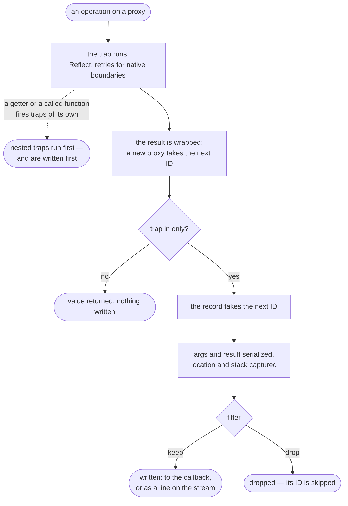

# Record format

What flugrekorder writes: the contract a reader of records can rely on. The latest format comes first.

A **callback** receives each record as an object. A **stream** receives newline-delimited JSON: one header line per session, then one record per line. The format describes both; where JSON and the callback differ, it says so.

## Versioning

Every session that writes to a stream starts with a header naming the format of its records:

```json
{"$flugrekorder":{"format":"2.0"}}
```

- The format is `major.minor`. A **minor** change only adds what a reader can ignore — a new property, a new tag, a new trap name. A **major** change alters the meaning or shape of what exists.
- A reader accepts the majors it knows and ignores properties it does not know.
- A stream without a header follows format `1.0`.
- The number changes only with a stable release: all work on the format between two releases shares one number, so a released format never skips a step.
- Callbacks receive no header. A callback runs in the code that installed flugrekorder, so the records it receives always match the types it was compiled against: `Rekording`, `Serialized` and `StreamHeader`.

---

## Format 2.0

*flugrekorder 2.0.0. In progress until that release; the [ID order](#ids-and-order) may still change.*

### A stream

```jsonc
{"$flugrekorder":{"format":"2.0"}}   // one header per session, before its first record
{"id":"#2","trap":"get",...}         // then one record per line
{"id":"#3","trap":"apply",...}
{"$flugrekorder":{"format":"2.0"}}   // a second session writing to the same stream
{"id":"#2","trap":"set",...}         // IDs are unique within a session, not across sessions
```

### A record

```jsonc
{
  // Unique within the session: "#" and a counter by default, or what the `id` option returns.
  "id": "#15",

  // The Reflect trap that fired — or a retry of it: "apply:native", "apply:structure", "apply:private".
  "trap": "apply",

  // How the proxy the trap fired on was reached; null for traps without a key or a call.
  "origin": { "trap": "apply", "source": "#13" },

  // The trap's arguments as Reflect received them; see "args per trap".
  "args": [
    { "$unwrap": { "$proxy": "#13" } },   // the target itself, known to the session as proxy #13
    { "$proxy": "#1" },                   // `this`: the proxy the function was called on
    [21]                                  // the call's arguments, one entry per argument
  ],

  // What the trap returned. In a stream, left out when it is `undefined`.
  "result": 42,

  // Milliseconds since the epoch, taken when the record is built: after the trap has returned.
  "timestamp": 1793444190641,

  // With the `location` option, on apply and construct records: where the called function
  // is defined. null for native functions.
  "location": { "file": "src/math.ts", "line": 6, "column": 30 },

  // With the `stack` option: the calls that made the trap fire, nearest first.
  // `function` is "" for anonymous code.
  "stack": [{ "file": "src/app.ts", "line": 12, "column": 3, "function": "main" }]
}
```

Paths in `location` and `stack` are in unix notation, relative to the working directory — or a name such as `node:fs`.

### `origin`

How the proxy a trap fired on was reached — or, for traps that produce a value, the origin that value's proxy gets.

| `origin` | On traps | Meaning |
|---|---|---|
| `{ "trap", "parent", "key" }` | `get`, `set`, `has`, `deleteProperty`, `defineProperty`, `getOwnPropertyDescriptor` | the property `key` of proxy `parent`. A symbol key is written as `"Symbol(description)"`. |
| `{ "trap", "source" }` | `apply`, `construct`, and their retries | a call of the function proxy `source` |
| `null` | `ownKeys`, `getPrototypeOf`, `setPrototypeOf`, `isExtensible`, `preventExtensions` | no key, no call |

### `args` per trap

`args` is the argument list of the Reflect function the trap relays to. The first entry is always the target, as `{ "$unwrap": { "$proxy": id } }`.

| `trap` | `args` | `result` |
|---|---|---|
| `get` | target, key, receiver | the property's value |
| `set` | target, key, value, receiver | `true` / `false` |
| `has` | target, key | `true` / `false` |
| `deleteProperty` | target, key | `true` / `false` |
| `defineProperty` | target, key, descriptor | `true` / `false` |
| `getOwnPropertyDescriptor` | target, key | the descriptor, or `undefined` |
| `ownKeys` | target | the keys |
| `getPrototypeOf` | target | the prototype |
| `setPrototypeOf` | target, prototype | `true` / `false` |
| `isExtensible` | target | `true` / `false` |
| `preventExtensions` | target | `true` / `false` |
| `apply`, `apply:native`, `apply:structure`, `apply:private` | target, this, call arguments (an array) | what the function returned |
| `construct` | target, call arguments (an array), new target | the new instance |

A retried call records what the retry passed: `apply:native` and `apply:private` have the real target as `this` (`$unwrap`), `apply:structure` has unwrapped call arguments.

### Values

Values in `args` and `result` are written as JSON where JSON can hold them, and as a tag where it cannot. Tags are objects with a single key starting with `$`; plain objects from the application are never tags.

| Value | Written as |
|---|---|
| a proxy | `{ "$proxy": "#4" }` |
| a target known to the session, passed unwrapped | `{ "$unwrap": { "$proxy": "#4" } }` |
| string, boolean, `null`, finite number | itself |
| `NaN` | `{ "$number": "NaN" }` |
| `Infinity` | `{ "$number": "Infinity" }` |
| `-Infinity` | `{ "$number": "-Infinity" }` |
| `-0` | `{ "$number": "-0" }` |
| `bigint` | `{ "$bigint": "42" }` — `BigInt(value)` reads it back |
| symbol | `{ "$symbol": "description" }` |
| `undefined` | `{ "$undefined": true }` — except a record's `result`, which is left out |
| `Date` | `{ "$date": "2026-10-31T00:00:00.000Z" }`, or `"Invalid Date"` — `new Date(value)` reads either back |
| `RegExp` | `{ "$regexp": { "source": "a+", "flags": "gi" } }` |
| `Error` | `{ "$error": { "name": "TypeError", "message": "boom" } }` |
| `URL` | `{ "$url": "https://example.test/" }` |
| function | `{ "$function": "name" }` — `""` when anonymous |
| `Map` | `{ "$map": [[key, value], …] }` — keys and values written as values |
| `Set` | `{ "$set": [value, …] }` |
| binary data | `{ "$binary": { "type": "Uint8Array", "base64": "aGk=" } }` — `type` is the built-in's name, or `"Buffer"` |
| `WeakMap`, `WeakSet` | `{ "$weakmap": null }`, `{ "$weakset": null }` — their contents cannot be read |
| array | an array of values; a hole is `{ "$undefined": true }` |
| any other object | its own enumerable string-keyed properties, as values |

Not written: symbol-keyed properties of objects, and the class of an instance (reading it could run application code). A boxed primitive (`new Number(1)`) is an object without own properties: `{}`.

**Limits** set by options:

| | Written as |
|---|---|
| an object or array nested deeper than `depth` | `"[…]"` — `Map` and `Set` count as nesting; single-value built-ins such as `Date` do not |
| a string longer than `truncate` | its first `truncate` characters and `"…"` — base64 included |
| a property a `redact` function redacts | `"[redacted]"`, the string the function returned, or left out |
| an object that contains itself | `{ "$proxy": "?" }` where it would repeat |

**With `values: false`**, no value is written. References (`$proxy`, `$unwrap`), the key of a property trap, the keys `ownKeys` returns, and the argument list of a call keep their shape; every other value is `{ "$omitted": kind }`, where `kind` is `"null"`, `"Array<3>"` (its length), binary data as `"Uint8Array<32>"` (type and length), or the value's `typeof`.

### IDs and order

Proxies and records draw their IDs from one counter per session. A trap that is not in `only` takes no ID. A record dropped by `filter` has already taken one, so IDs can skip.



So in format 2.0:

- A record is written when its trap **returns**. A trap that throws writes nothing.
- Records arrive in the order their traps returned: a call made inside another call is written before it.
- Within a session, every record's ID is higher than the IDs of the records before it, and higher than the IDs of proxies created while its trap ran: `"result": { "$proxy": "#19" }` on record `#20`.

### Changes from format 1.0

- Streams start with a header.
- `bigint`, `NaN`, `±Infinity`, `-0`, symbols, `undefined`, `Date`, `RegExp`, `Error`, `URL`, functions, `Map`, `Set`, binary data and weak collections are written as tags. In 1.0, a `bigint` made `stream` mode throw into the application; `NaN` and `Infinity` became `null`; `-0` became `0`; symbols and `undefined` were left out, or `null` inside an array; the built-ins became `{}`, and binary data one property per byte.
- A symbol key in `args` is `{ "$symbol": … }`; in 1.0 it became `null` in a stream.

---

## Format 1.0

*Every stream without a header: flugrekorder 1.x up to 2.0.0-beta.3.*

### A record

```jsonc
{
  "id": "#15",
  "trap": "apply",
  "origin": { "trap": "apply", "source": "#13" },
  "args": [
    { "$unwrap": { "$proxy": "#13" } },
    null,                                 // `undefined` became null inside an array
    [21]
  ],
  "result": 42,                           // left out when `undefined`
  "timestamp": 1793444190641,
  "location": { "file": "src/math.ts", "line": 6, "column": 30 },              // since 2.0.0-beta.2
  "stack": [{ "file": "src/app.ts", "line": 12, "column": 3, "function": "main" }]  // since 2.0.0-beta.2
}
```

Fields, `origin`, `args` per trap, references, limits and the ID order are as in format 2.0, with these differences:

- **Values** were written as JavaScript held them: `JSON.stringify` decided the rest. `NaN` and `±Infinity` became `null`, `-0` became `0`, symbols and `undefined` were left out (`null` inside an array), and a `bigint` made `JSON.stringify` throw into the application. flugrekorder copied an object's own enumerable string-keyed properties, so `Date`, `RegExp`, `Error`, `URL`, `Map`, `Set`, functions, `ArrayBuffer` and `DataView` became `{}`, and a typed array or `Buffer` one property per byte.

Format 1.0 also covers the releases before 2.0.0-beta.3, which wrote records of the same shape with less in them:

| | Before |
|---|---|
| `has` and `deleteProperty` have a property origin | 2.0.0-beta.3 — their origin was `null` |
| `getPrototypeOf` and `setPrototypeOf` have a `null` origin | 2.0.0-beta.3 — they had a property origin with a key that was not one (`"undefined"`) |
| traps left out of `only` proxy their results | 2.0.0-beta.3 — their results were not proxied, so nothing reached through them was recorded |
| `values: false` and `{ "$omitted": kind }` | 2.0.0-beta.3 |
| `location` and `stack` | 2.0.0-beta.2 |
